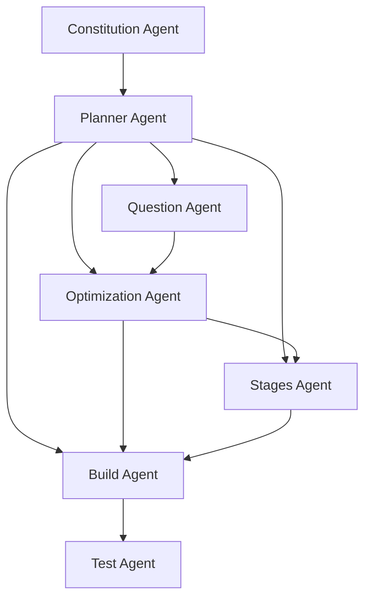

# Phase D Headless CLI Live Dry-Run Report

Date: 2026-08-06
Baseline: `78bffa8`
Scratch project: created with `mktemp -d` as `.kgpe-phase-d.kaLW6O`, then deleted after evidence collection.

Latest status: **fix attempt 1 of 3 stopped at a new `phase5.test` defect.** The original
`phase5.build` failure below remains as the first-attempt record. See “Fix attempt 1” for the
fresh rerun and current state.

## Verdict

**The graph did not execute end to end.** The scheduler executed the graph for the first time,
correctly parked at the phase0 human gate, and then executed phases 0 through 4 under
`--auto-approve`. It failed at `phase5.build`; `phase5.test` never ran.

The failure is a real manifest/agent CLI contract defect and was not worked around. The protected
Phase B manifest invokes BuildAgent as:

```text
--plans-dir ${PLANS_DIR} --prompt ${PROMPT} --yolo
```

The scheduler substitutes `${PROMPT}` with `Foundation graph pipeline execution`.
`BuildAgent.sh` interprets the `--prompt` value as a prompt-file path and exits 11:

```text
Prompt file not found: Foundation graph pipeline execution
```

The Phase B manifests were not modified. This defect requires escalation to the manifest/agent
contract owner.

## Scratch project

The scratch project contained `Constitution/`, `Plans/`, `Guides/`, `Docs/`, and `Design/`, plus
a minimal `Constitution/C0.tex` and `Constitution/C1.tex`.

## Captured transcripts

### `orch graph validate --project-dir <tmp>`

Exit: 0

```text
valid: true
nodes: 7
  phase0.constitution: Constitution Agent
  phase1.planner: Planner Agent
  phase2.question: Question Agent
  phase3.optimization: Optimization Agent
  phase4.stages: Stages Agent
  phase5.build: Build Agent
  phase5.test: Test Agent
edges: 10
  phase0.constitution -> phase1.planner
  phase1.planner -> phase2.question
  phase1.planner -> phase3.optimization
  phase1.planner -> phase4.stages
  phase1.planner -> phase5.build
  phase2.question -> phase3.optimization
  phase3.optimization -> phase4.stages
  phase3.optimization -> phase5.build
  phase4.stages -> phase5.build
  phase5.build -> phase5.test
stages: [["phase0.constitution"], ["phase1.planner"], ["phase2.question"], ["phase3.optimization"], ["phase4.stages"], ["phase5.build"], ["phase5.test"]]
critical path: ["phase0.constitution", "phase1.planner", "phase2.question", "phase3.optimization", "phase4.stages", "phase5.build", "phase5.test"]
errors: []
warnings: []
```

### `orch graph render --format mermaid --project-dir <tmp>`

Exit: 0



### `orch pipeline --dry-run --project-dir <tmp>`

Exit: 3 (`GATE_EXIT_CODE`, the documented distinct gate-park exit)

```text
[SUCCESS] Phase 0 dry run complete
node phase0.constitution: AwaitingApproval (exit 0)
human gate: node phase0.constitution is AwaitingApproval; rerun with --auto-approve to proceed (exit 3)
```

### `orch pipeline --dry-run --auto-approve --project-dir <tmp>`

Exit: 1. The transcript below preserves the scheduler-relevant output. BuildAgent also printed its
existing banner, plan discovery, and artifact setup diagnostics between the phase4 and failure
lines.

```text
[SUCCESS] Phase 0 dry run complete
node phase0.constitution: AwaitingApproval (exit 0)
node phase0.constitution: approved (--auto-approve)
[SUCCESS] Phase 1 dry run complete
node phase1.planner: Succeeded (exit 0)
[SUCCESS] Phase 2 dry run complete
node phase2.question: Succeeded (exit 0)
[SUCCESS] Phase 3 dry run complete
node phase3.optimization: Succeeded (exit 0)
[SUCCESS] Phase 4 dry run complete
node phase4.stages: Succeeded (exit 0)
YOLO mode enabled: verbose + skip-chat-id + streaming + max-attempts=5
No sequence.md found, auto-discovering plans
Discovered 5 plan(s) in <tmp>/Plans
Validating configuration ...
Validating configuration failed
Prompt file not found: Foundation graph pipeline execution
node phase5.build: Failed (exit 11)
HeadlessCommandError: NodeFailedError: node 'phase5.build' exited 11
```

## Final node states and persisted graph state

The exact state-bearing portion of `Artifacts/graph_state.json` was:

```json
{
  "schemaVersion": 1,
  "states": {
    "phase0.constitution": "succeeded",
    "phase1.planner": "succeeded",
    "phase2.question": "succeeded",
    "phase3.optimization": "succeeded",
    "phase4.stages": "succeeded",
    "phase5.build": "failed",
    "phase5.test": "pending"
  },
  "attempts": {
    "phase0.constitution": 1,
    "phase1.planner": 1,
    "phase2.question": 1,
    "phase3.optimization": 1,
    "phase4.stages": 1,
    "phase5.build": 1,
    "phase5.test": 0
  },
  "resumePosition": []
}
```

The persisted `nodes` array contained the seven unchanged Phase B manifests in the same order as
the derived seven stages. It is omitted above only to avoid duplicating every manifest field.

## Result artifacts and network/AI evidence

`result.json` status was `dry_run` for ConstitutionAgent, PlannerAgent, QuestionAgent,
OptimizationAgent, and StagesAgent. ConstitutionAgent wrote two dry-run results because the gate
run and auto-approve run each executed phase0. All available results had empty `errors`; phase0
had `requiresApproval: true`, and phases 1-4 had `requiresApproval: false`.

BuildAgent failed configuration validation before producing a phase5 `result.json`.
TestAgent did not execute and produced no result. Therefore the requirement that every phase
script produce `status: dry_run` is **not met**.

No AI provider command was invoked. The BuildAgent diagnostic printed an empty `AI CLI Command:`
before failing configuration validation. StagesAgent completed its dry-run without an AI call.

## Defects and first-attempt statement

1. **Blocking defect:** `phase5.build`'s protected manifest passes a literal description through
   `--prompt`, while BuildAgent treats that flag as a file path. Exit 11 prevents phase5.test from
   becoming ready.
2. The graph did **not** execute end to end on the first attempt.
3. No acceptance criteria, tests, `src/startup.rs`, or Phase B manifests were changed to create a
   pass.

## Fix attempt 1 — authorized BuildAgent flag correction

The independently confirmed root cause of the first failure was deeper than the initial report:

- `BuildAgent.sh` documents `--prompt <file.txt>` as a path and `--prompt-string <str>` as a
  literal string.
- Its parser assigns `--prompt` to `PROMPT_FILE`, and `lib/build/detect.sh` exits 11 when that
  path does not exist.
- Root `CLAUDE.md` incorrectly showed a description passed to `--prompt`, and the Phase B
  manifest faithfully copied that bad documentation.

Under the operator's narrow authorization, only the `phase5.build` argument name was changed from
`--prompt` to `--prompt-string`; no other manifest field changed. The three existing BuildAgent
examples in root `CLAUDE.md` now distinguish `--prompt <file.txt>` from
`--prompt-string "description"`. `src/startup.rs` remained byte-for-byte untouched by Phase D
(SHA-256 remained `c0cc3affffbf94ffc954062a2b8aed0c5041c49e027653f3a2be9556bdbfe3fb`).

### Fresh scratch project

A new project was created using `mktemp -d` as `.kgpe-phase-d-fix1.kNEhCl`, independently of the
first attempt. It contained the five Foundation folders and minimal `C0.tex` and `C1.tex` files.

### Fix-attempt transcript: graph validation

Command: `orch graph validate --project-dir <tmp>`

Exit: 0

```text
valid: true
nodes: 7
  phase0.constitution: Constitution Agent
  phase1.planner: Planner Agent
  phase2.question: Question Agent
  phase3.optimization: Optimization Agent
  phase4.stages: Stages Agent
  phase5.build: Build Agent
  phase5.test: Test Agent
edges: 10
  phase0.constitution -> phase1.planner
  phase1.planner -> phase2.question
  phase1.planner -> phase3.optimization
  phase1.planner -> phase4.stages
  phase1.planner -> phase5.build
  phase2.question -> phase3.optimization
  phase3.optimization -> phase4.stages
  phase3.optimization -> phase5.build
  phase4.stages -> phase5.build
  phase5.build -> phase5.test
stages: [["phase0.constitution"], ["phase1.planner"], ["phase2.question"], ["phase3.optimization"], ["phase4.stages"], ["phase5.build"], ["phase5.test"]]
critical path: ["phase0.constitution", "phase1.planner", "phase2.question", "phase3.optimization", "phase4.stages", "phase5.build", "phase5.test"]
errors: []
warnings: []
```

### Fix-attempt transcript: Mermaid rendering

Command: `orch graph render --format mermaid --project-dir <tmp>`

Exit: 0


### Fix-attempt transcript: human gate

Command: `orch pipeline --dry-run --project-dir <tmp>`

Exit: 3

```text
[SUCCESS] Phase 0 dry run complete
node phase0.constitution: AwaitingApproval (exit 0)
human gate: node phase0.constitution is AwaitingApproval; rerun with --auto-approve to proceed (exit 3)
```

### Fix-attempt transcript: auto-approve execution

Command: `orch pipeline --dry-run --auto-approve --project-dir <tmp>`

Exit: 1

The complete terminal output included BuildAgent's existing banner and one dry-run cycle for each
of the five discovered markdown files. The scheduler-relevant transcript and exact new failure
were:

```text
[SUCCESS] Phase 0 dry run complete
node phase0.constitution: AwaitingApproval (exit 0)
node phase0.constitution: approved (--auto-approve)
[SUCCESS] Phase 1 dry run complete
node phase1.planner: Succeeded (exit 0)
[SUCCESS] Phase 2 dry run complete
node phase2.question: Succeeded (exit 0)
[SUCCESS] Phase 3 dry run complete
node phase3.optimization: Succeeded (exit 0)
[SUCCESS] Phase 4 dry run complete
node phase4.stages: Succeeded (exit 0)
[DRY RUN] Would run: claude ...
[DRY RUN] Would run: BuildLint.sh
(the same dry-run pair was printed for all five discovered markdown files)
All 5 plan(s) completed successfully
BUILD_AGENT_STATUS=success
node phase5.build: Succeeded (exit 0)
[ERROR] Unknown option: --project-dir
Test Agent - Complete Test Automation Pipeline
HeadlessCommandError: NodeFailedError: node 'phase5.test' exited 11
node phase5.test: Failed (exit 11)
```

Per the operator's stop condition, this different `phase5.test` failure was reported and not
chased. The `phase5.test` manifest supplies `--project-dir ${PROJECT_DIR}`, but the live
`testAgent.sh --help` output does not support `--project-dir`; its parser rejects it with exit 11.

### Fix-attempt persisted graph state

The state file's node order exactly matched the derived seven-stage order. Every node reached a
terminal state, but the last state was failure rather than successful completion:

```json
{
  "schemaVersion": 1,
  "nodeOrder": [
    "phase0.constitution",
    "phase1.planner",
    "phase2.question",
    "phase3.optimization",
    "phase4.stages",
    "phase5.build",
    "phase5.test"
  ],
  "states": {
    "phase0.constitution": "succeeded",
    "phase1.planner": "succeeded",
    "phase2.question": "succeeded",
    "phase3.optimization": "succeeded",
    "phase4.stages": "succeeded",
    "phase5.build": "succeeded",
    "phase5.test": "failed"
  },
  "attempts": {
    "phase0.constitution": 1,
    "phase1.planner": 1,
    "phase2.question": 1,
    "phase3.optimization": 1,
    "phase4.stages": 1,
    "phase5.build": 1,
    "phase5.test": 1
  },
  "resumePosition": []
}
```

### Additional dry-run defects observed

1. Before its dry-run cycles, BuildAgent printed `Cloning swiftDocs repository...` followed by
   `Failed to clone swiftDocs repository`. Attempting a clone violates PHASE_CONTRACT §2's
   `--dry-run` requirement of no network calls. No provider CLI was actually executed; each
   provider line was explicitly `[DRY RUN] Would run: claude ...`.
2. ConstitutionAgent through StagesAgent wrote contract `result.json` files with
   `status: dry_run`. BuildAgent succeeded but wrote its legacy `Artifacts/build_*` output rather
   than `Artifacts/phase5_*/result.json`; TestAgent failed during argument parsing and wrote no
   result. Thus the every-script `result.json` acceptance criterion remains unmet.

### Fix-attempt verification

Before the live rerun:

```text
cargo test
55 passed; 0 failed

cargo clippy --all-targets -- -D warnings
Finished successfully

cargo build --release
Finished successfully
```

**Fix-attempt verdict:** the authorized correction genuinely fixed `phase5.build`, but the graph
still did not complete successfully because `phase5.test` exposed a different manifest/CLI
contract defect. No acceptance criterion was weakened and no workaround was applied.
