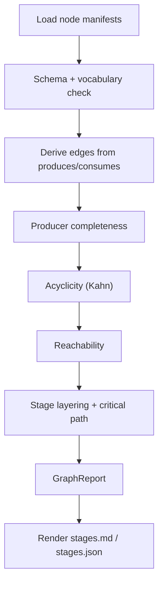
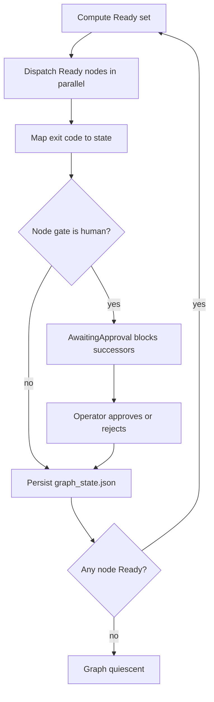
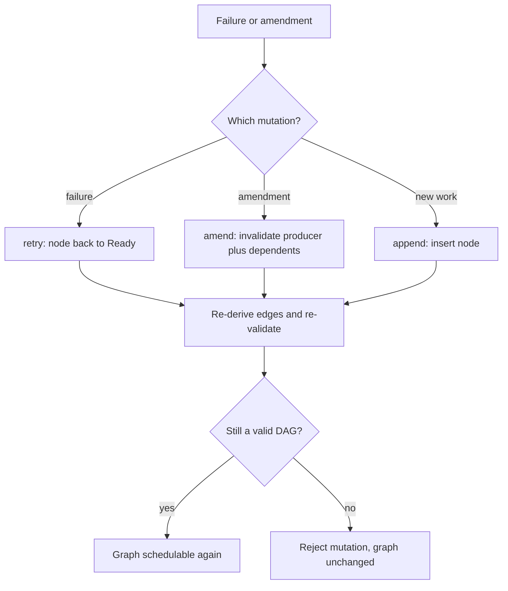

# KGPE Graph Engine — Implementation Plan

Tech contract: [`tech-plan.md`](tech-plan.md)
Loops: [`loop.md`](loop.md) · State: [`STATE.md`](STATE.md)

---

## 1. Epic Brief

Convert the agents described in the Foundation Constitution into a single graph formalism —
the Knowledge-Graph Prompt Engine (KGPE) — where every agent is a node, every dependency is a
derived edge, and one engine executes both the agent pipeline and the work/task DAG.

### Context & Problem

Two structures in this repo should be graphs and currently are not:

1. **The agent pipeline.** `.Foundation/Agents/phases/PHASE_CONTRACT.md` §6 mandates phases run
   "strictly in order 0→5", and `phase5/orchestrator/src/pipeline_engine.rs` implements exactly
   that — a linear march over a fixed phase enum. The real dependencies are not linear (the
   Question Agent's output gates Optimization, not Stages), and two Constitution behaviors —
   Phase 5 debug loops and Phase 6 amendments ("only changed components re-executed") — cannot
   be expressed as a line at all.

2. **The work/task DAG.** Article V calls the Planner "the *compiler* of Foundation" and
   requires it to generate a task DAG. In practice `phase4/StagesAgent.sh` asks an LLM to emit
   the whole DAG in one call and validates it with `jq empty` — a syntax check, not a graph
   check. There is no graph data structure anywhere in the repo, no cycle detection, and no
   topological sort. `Design/`, which Article V §3 designates for the Plan Template Library,
   is empty.

Who is affected: anyone running the pipeline gets a fixed sequence that cannot resume
partially, cannot re-run only what changed, and cannot detect that the "DAG" it was handed is
circular or has unreachable work.

What changes: both structures become instances of one node/edge model with derived,
machine-checkable edges.

---

## 2. Core Flows

### Flow 1 — Build and validate a graph

Trigger: any manifest set is loaded (agent graph at startup, work graph after Phase 1).

1. Load all node manifests; schema-validate against the closed artifact-type vocabulary.
2. Derive edges: `A → B` iff `A.produces ∩ B.consumes ≠ ∅` (tech-plan §3.3).
3. Validate: producer completeness, acyclicity (Kahn), reachability.
4. Compute stage layering and critical path.
5. Emit `GraphReport`; render `stages.md` / `stages.json` from it.

Artifact output: `GraphReport` in memory; `Plans/stages.md`, `Plans/stages.json` on disk;
`Artifacts/graph_state.json` for resume.

### Flow 2 — Execute a validated graph

Trigger: operator runs the pipeline, or a work graph becomes available.

1. Compute the Ready set (all predecessors `Succeeded` or `Skipped`).
2. Dispatch all Ready nodes concurrently.
3. Map exit codes to states (0/10/11/20 per PHASE_CONTRACT.md §3).
4. `gate: "human"` nodes park in `AwaitingApproval` and block successors.
5. Persist state after every transition; recompute the Ready set; repeat until quiescent.

### Flow 3 — Mutate a running graph

Trigger: a node fails, or an artifact is amended post-deployment.

1. `retry` — failed node returns to `Ready` while attempts remain; else `HumanIntervention`.
2. `amend` — invalidate the changed ref's producer plus the transitive closure of its
   dependents; everything else stays `Succeeded`.
3. `append` — insert a node at runtime.
4. Re-derive edges and re-run full validation; reject the mutation if it introduces a cycle.

---

## 3. Approach

Three phases. A and B run in parallel against the tech-plan contract — the same pattern that
let SPEC-A (`phases/`) and SPEC-B (`orchestrator/`) be built simultaneously without collision.
C integrates once both are green.

| Phase | Worker | Tree owned | Deliverable |
|---|---|---|---|
| A | Codex | `phase5/orchestrator/src/kgpe/` | The engine: types, manifests, derivation, validation, execution, mutation, persistence |
| B | Kimi | `.Foundation/Agents/phases/` | Node manifests for all agents; Phase 1 emits work-node manifests; Phase 4 stops inventing edges |
| C | TBD after A+B | `pipeline_engine.rs`, `chat.rs`, `ui/pipeline.rs` | Replace linear phase marching with graph execution; `/graph` commands |

---

## 4. Observations

- `file:.Foundation/Agents/phases/PHASE_CONTRACT.md:118` — "Runs phases strictly in order 0→5
  unless the user pins a phase" is the rule Phase C supersedes. Exit codes (§3) and
  `result.json` (§4) stay binding.
- `file:.Foundation/Agents/phases/phase5/orchestrator/src/pipeline_engine.rs:46` — the phase
  enum maps to fixed script names; this is the seed to generalize into manifest-driven nodes.
- `file:.Foundation/Agents/phases/phase4/StagesAgent.sh:200` — `jq empty` is the entire current
  validation of the DAG. Replaced by tech-plan §4.
- `file:.Foundation/Agents/phases/phase1/PlannerAgent.sh:164` — plans are emitted as
  `---FILE:---`-marked free markdown; Phase B adds structured node manifests alongside.
- `file:.Foundation/Foundation-constitution/Foundation-Constitution.tex:851` — Article V §2.3
  "Generate Task Graph: Create directed acyclic graph (DAG) of tasks" — the requirement this
  epic finally implements.
- `file:.Foundation/Foundation-constitution/Foundation-Constitution.tex:952` — Article VII §3
  Data Contracts is the constitutional basis for typed `produces`/`consumes`.

---

## 5. Files Modified

| File | Phase | Change |
|---|---|---|
| `phase5/orchestrator/src/kgpe/*.rs` | A | New engine module (6 files) |
| `phase5/orchestrator/src/lib.rs` | A | Register `kgpe` module |
| `phase5/orchestrator/tests/kgpe_*.rs` | A | Derivation, validation, mutation, persistence tests |
| `.Foundation/Agents/phases/phase{0..4}/node.json` | B | Agent-graph node manifests |
| `.Foundation/Agents/phases/phase5/node.json` | B | Build/test agent manifests |
| `.Foundation/Agents/phases/phase1/PlannerAgent.sh` | B | Emit work-node manifests |
| `.Foundation/Agents/phases/phase4/StagesAgent.sh` | B | Emit manifests; drop LLM edge invention |
| `.Foundation/Agents/phases/tests/bats/kgpe_manifests.bats` | B | Manifest schema tests |
| `phase5/orchestrator/src/pipeline_engine.rs` | C | Graph execution replaces linear march |
| `.Foundation/Agents/phases/PHASE_CONTRACT.md` | C | Amend §6 sequencing rule |

---

## 6. Plan Audit

| Step | Planned outcome | Actual | Deviation |
|---|---|---|---|
| A | Engine module green under `cargo test` | — | — |
| B | Manifests + bats green | — | — |
| C | Pipeline runs off the graph | — | — |
