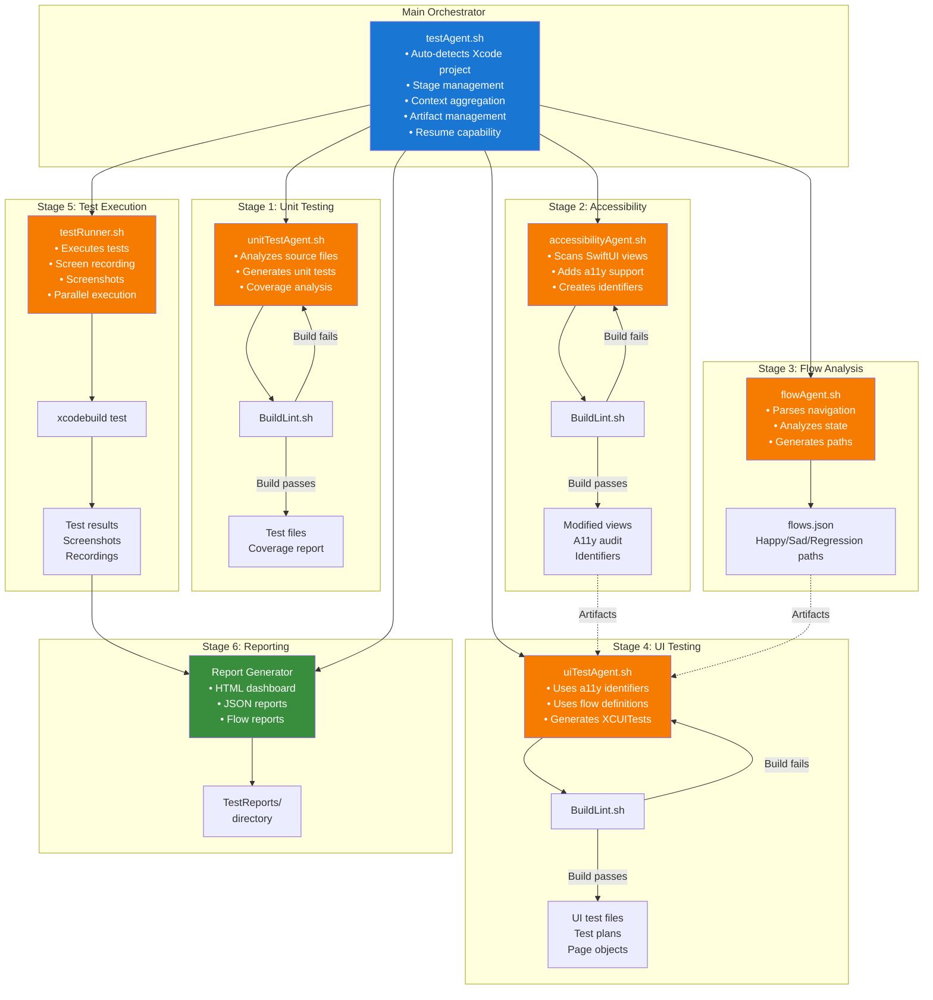
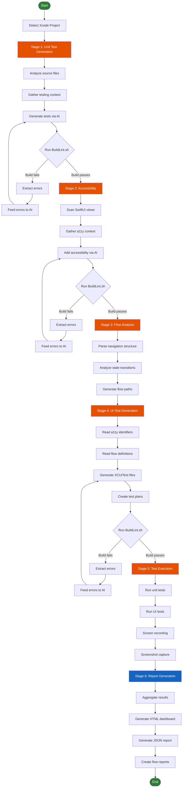
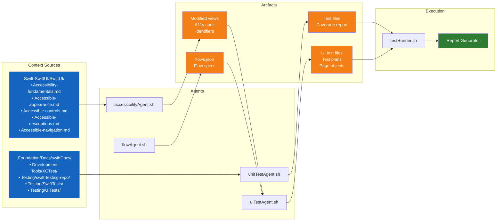
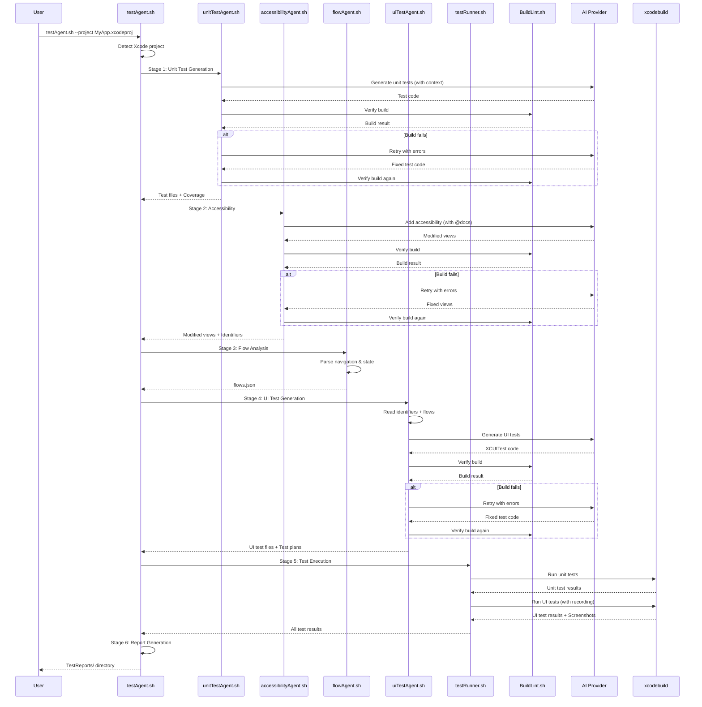

# TestAgent System Plan

## Overview

A comprehensive test automation system that orchestrates unit tests, accessibility compliance, UI tests, and test execution with reporting. Built on top of the existing BuildAgent/BuildLint infrastructure.

---

## Architecture

### System Architecture Diagram



### Execution Pipeline Flow



### Data Flow & Dependencies



### Component Interaction Sequence



### Shared Infrastructure

```mermaid
graph TB
    subgraph "Shared Libraries"
        TU[lib/testUtils.sh<br/>• detect_xcode_project<br/>• gather_test_context<br/>• run_build_lint<br/>• run_ai_cli<br/>• generate_report]
        TCP[lib/testContextPaths.sh<br/>• TEST_CONTEXT_PATHS[]<br/>• ACCESSIBILITY_CONTEXT_PATHS[]]
    end
    
    subgraph "Templates"
        T1[templates/unitTest.swift.tmpl]
        T2[templates/uiTest.swift.tmpl]
        T3[templates/pageObject.swift.tmpl]
    end
    
    subgraph "Agents"
        TA[testAgent.sh]
        UTA[unitTestAgent.sh]
        AA[accessibilityAgent.sh]
        FA[flowAgent.sh]
        UITA[uiTestAgent.sh]
        TR[testRunner.sh]
    end
    
    TU --> TA
    TU --> UTA
    TU --> AA
    TU --> FA
    TU --> UITA
    TU --> TR
    
    TCP --> UTA
    TCP --> AA
    
    T1 --> UTA
    T2 --> UITA
    T3 --> UITA
    
    style TU fill:#1976d2,color:#fff
    style TCP fill:#1976d2,color:#fff
    style T1 fill:#e65100,color:#fff
    style T2 fill:#e65100,color:#fff
    style T3 fill:#e65100,color:#fff
```

### AI Provider Integration

```mermaid
graph TB
    subgraph "AI Providers"
        CURSOR[cursor<br/>Default<br/>Auto-authenticated]
        CLAUDE[claude<br/>ANTHROPIC_API_KEY]
        CODEX[codex<br/>OPENAI_API_KEY]
        GEMINI[gemini<br/>GOOGLE_API_KEY]
        LETTA[letta<br/>LETTA_API_KEY<br/>Stateful agents]
    end
    
    subgraph "Cursor Features"
        DOCS[@docs SwiftUI<br/>accessibility<br/>fundamentals]
        DOCS2[@docs SwiftUI<br/>accessible<br/>appearance]
        DOCS3[@docs SwiftUI<br/>accessible<br/>controls]
    end
    
    subgraph "Agents Using AI"
        UTA[unitTestAgent.sh]
        AA[accessibilityAgent.sh]
        UITA[uiTestAgent.sh]
    end
    
    CURSOR --> DOCS
    CURSOR --> DOCS2
    CURSOR --> DOCS3
    
    CURSOR --> UTA
    CLAUDE --> UTA
    CODEX --> UTA
    GEMINI --> UTA
    LETTA --> UTA
    
    CURSOR --> AA
    CLAUDE --> AA
    DOCS --> AA
    DOCS2 --> AA
    DOCS3 --> AA
    
    CURSOR --> UITA
    CLAUDE --> UITA
    CODEX --> UITA
    
    style CURSOR fill:#2e7d32,color:#fff
    style LETTA fill:#e65100,color:#fff
    style DOCS fill:#1565c0,color:#fff
    style DOCS2 fill:#1565c0,color:#fff
    style DOCS3 fill:#1565c0,color:#fff
```

---

## 1. testAgent.sh (Main Orchestrator)

### Purpose
Coordinates all test agents in sequence, managing context and passing artifacts between stages.

### Features
- **Auto-detection**: Finds nearest Xcode project (like BuildAgent)
- **Stage management**: Runs agents in order, stops on failure
- **Context aggregation**: Combines docs from multiple sources
- **Artifact management**: Tracks outputs from each agent
- **Resume capability**: Can resume from a specific stage

### CLI Interface
```bash
# Full pipeline
testAgent.sh --project MyApp.xcodeproj

# Run specific stages
testAgent.sh --stage unit         # Only unit tests
testAgent.sh --stage accessibility # Only accessibility
testAgent.sh --stage ui           # Only UI tests
testAgent.sh --stage run          # Only run existing tests

# Resume from stage
testAgent.sh --resume-from accessibility

# With AI provider
testAgent.sh --ai-provider claude --yolo
```

### Execution Flow
```
1. Detect Xcode project
2. Run unitTestAgent.sh
3. Run accessibilityAgent.sh
4. Run flowAgent.sh (determine test paths)
5. Run uiTestAgent.sh (generate UI tests)
6. Run testRunner.sh (execute all tests)
7. Generate final report
```

---

## 2. unitTestAgent.sh

### Purpose
Generates unit tests for Swift code using AI with testing documentation context.

### Context Sources
```
.Foundation/Docs/swiftDocs/
├── Development-Tools/XCTest/           # XCTest framework docs
├── Testing/swift-testing-repo/         # Swift Testing framework
├── Testing/SwiftTests/                 # Swift test patterns
├── Testing/XCTest/                     # XCTest detailed docs
├── Testing/Automate-your-development-process-with-the-app-store-connect-API.md
├── Testing/Create-practical-workflows-in-xcode-cloud.md
└── Testing/Fix-failures-faster-with-xcode-test-reports.md
```

### Features
- **Target detection**: Finds testable targets in project
- **Coverage analysis**: Identifies untested code paths
- **Test generation**: Creates XCTest or Swift Testing tests
- **Build verification**: Uses BuildLint.sh with retry loop
- **Incremental mode**: Only generates tests for changed files

### CLI Interface
```bash
# Generate tests for entire project
unitTestAgent.sh --project MyApp.xcodeproj

# Generate tests for specific files
unitTestAgent.sh --files "Sources/Models/*.swift"

# Use Swift Testing instead of XCTest
unitTestAgent.sh --framework swift-testing

# Target specific coverage percentage
unitTestAgent.sh --target-coverage 80

# With retry loop
unitTestAgent.sh --max-retries 5 --yolo
```

### Output
- Generated test files in `Tests/` or `MyAppTests/`
- Test coverage report
- Build verification status

### Build/Retry Flow
```
1. Analyze source files
2. Generate test code via AI
3. Run BuildLint.sh
4. If build fails:
   a. Extract errors
   b. Feed errors back to AI
   c. Retry (up to max-retries)
5. If build passes:
   a. Run tests
   b. Report coverage
```

---

## 3. accessibilityAgent.sh

### Purpose
Adds accessibility support to SwiftUI views using Apple's accessibility guidelines.

### Context Sources (SwiftUI Accessibility)
```
.Foundation/Docs/swiftDocs/Swift-SwiftUI/SwiftUI/
├── Accessibility-fundamentals.md       # Core concepts
├── Accessible-appearance.md            # Visual accessibility
├── Accessible-controls.md              # Interactive elements
├── Accessible-descriptions.md          # Labels and hints
└── Accessible-navigation.md            # VoiceOver navigation
```

### Additional Context
```
.Foundation/Docs/swiftDocs/
├── Testing/SwiftTests/SwiftUI-Accessibility-beond-the-basics.md
├── Core-Frameworks/UIKit/Accessibility-for-UIKit.md
└── App-Services/WidgetKit/Adding-accessible-descriptions-to-widgets-and-Live-Activities.md
```

### Cursor CLI Integration
Leverages Cursor's documentation indexing for Apple's accessibility docs:
- `@docs SwiftUI accessibility fundamentals`
- `@docs SwiftUI accessible appearance`
- `@docs SwiftUI accessible controls`
- `@docs SwiftUI accessible descriptions`
- `@docs SwiftUI accessible navigation`

### Features
- **View scanning**: Finds SwiftUI views missing accessibility
- **Automatic labeling**: Adds accessibilityLabel, accessibilityHint
- **Trait assignment**: Sets correct accessibilityTraits
- **Navigation ordering**: Configures accessibilityElement ordering
- **Dynamic type**: Ensures text scales properly
- **Color contrast**: Validates contrast ratios

### CLI Interface
```bash
# Analyze and fix accessibility in project
accessibilityAgent.sh --project MyApp.xcodeproj

# Scan only (no modifications)
accessibilityAgent.sh --scan-only

# Fix specific views
accessibilityAgent.sh --files "Views/*.swift"

# Generate accessibility audit report
accessibilityAgent.sh --audit

# With Cursor's indexed docs
accessibilityAgent.sh --ai-provider cursor --use-docs
```

### Output
- Modified SwiftUI files with accessibility
- Accessibility audit report
- Accessibility identifiers for UI testing

---

## 4. flowAgent.sh

### Purpose
Analyzes app flows and determines happy path, sad path, and regression test scenarios.

### Features
- **Flow detection**: Parses navigation structure
- **State analysis**: Identifies state transitions
- **Path generation**: Creates test path specifications
- **Edge cases**: Identifies error handling paths

### Flow Types
```
Happy Path:   Normal successful user journeys
Sad Path:     Error conditions, validation failures, edge cases
Regression:   Previously broken flows, critical business logic
```

### CLI Interface
```bash
# Analyze all flows
flowAgent.sh --project MyApp.xcodeproj

# Focus on specific feature
flowAgent.sh --feature "Authentication"

# Output format
flowAgent.sh --output flows.json
flowAgent.sh --output flows.md
```

### Output Format (JSON)
```json
{
  "flows": [
    {
      "name": "User Login",
      "type": "happy",
      "steps": [
        {"action": "tap", "element": "emailField", "input": "user@example.com"},
        {"action": "tap", "element": "passwordField", "input": "password123"},
        {"action": "tap", "element": "loginButton"},
        {"action": "verify", "element": "homeScreen", "state": "visible"}
      ]
    },
    {
      "name": "Login - Invalid Credentials",
      "type": "sad",
      "steps": [
        {"action": "tap", "element": "emailField", "input": "user@example.com"},
        {"action": "tap", "element": "passwordField", "input": "wrong"},
        {"action": "tap", "element": "loginButton"},
        {"action": "verify", "element": "errorAlert", "state": "visible"}
      ]
    }
  ]
}
```

---

## 5. uiTestAgent.sh

### Purpose
Generates UI tests using accessibility identifiers and flow definitions from flowAgent.sh.

### Context Sources
```
.Foundation/Docs/swiftDocs/
├── Testing/UITests/                    # UI testing patterns
├── Testing/XCTest/                     # XCUITest framework
└── Testing/Fix-failures-faster-with-xcode-test-reports.md
```

### Dependencies
- Accessibility identifiers from accessibilityAgent.sh
- Flow definitions from flowAgent.sh

### Features
- **Test plan generation**: Creates XCUITest test plans
- **Flow-based tests**: Generates tests from flow definitions
- **Page object pattern**: Creates page objects for views
- **Wait strategies**: Implements proper async waiting
- **Screenshot capture**: Adds screenshot assertions

### CLI Interface
```bash
# Generate UI tests from flows
uiTestAgent.sh --flows flows.json

# Generate for specific flow types
uiTestAgent.sh --flows flows.json --type happy
uiTestAgent.sh --flows flows.json --type sad
uiTestAgent.sh --flows flows.json --type regression

# Generate test plans for Xcode
uiTestAgent.sh --generate-test-plan

# With specific device configurations
uiTestAgent.sh --devices "iPhone 15,iPad Pro"
```

### Output
- UI test files in `MyAppUITests/`
- Test plan files (`.xctestplan`)
- Page object files

---

## 6. testRunner.sh

### Purpose
Executes tests with screen recording, screenshot capture, and comprehensive reporting.

### Features
- **Multi-destination**: Run on multiple simulators
- **Screen recording**: Record test execution
- **Screenshot capture**: Capture at key points (pass/fail)
- **Parallel execution**: Run tests in parallel
- **Report generation**: HTML/JSON/Markdown reports
- **Failure analysis**: Group and analyze failures

### CLI Interface
```bash
# Run all tests
testRunner.sh --project MyApp.xcodeproj --scheme MyAppTests

# Run with recording
testRunner.sh --record --screenshots

# Run specific test plan
testRunner.sh --test-plan UITests.xctestplan

# Run on multiple devices
testRunner.sh --destinations "iPhone 15,iPhone SE,iPad Pro"

# Parallel execution
testRunner.sh --parallel --max-concurrent 4

# Generate reports
testRunner.sh --report html --report-dir ./TestReports
```

### Recording Options
```bash
--record              # Enable screen recording
--screenshots         # Capture screenshots at pass/fail
--screenshot-on-fail  # Only capture on failures
--video-quality high  # Video quality (low/medium/high)
--keep-recordings     # Don't delete after successful tests
```

### Report Format
```
TestReports/
├── index.html                 # Summary dashboard
├── flows/
│   ├── user-login-happy.html  # Individual flow reports
│   ├── user-login-sad.html
│   └── checkout-regression.html
├── screenshots/
│   ├── pass/                  # Successful test screenshots
│   └── fail/                  # Failed test screenshots
├── recordings/
│   └── *.mp4                  # Screen recordings
└── report.json                # Machine-readable report
```

---

## 7. Shared Infrastructure

### Common Functions (testUtils.sh)
```bash
# Xcode project detection (from BuildAgent)
detect_xcode_project()

# Context gathering for testing docs
gather_test_context()

# Build verification wrapper
run_build_lint()

# AI CLI wrapper (multi-provider)
run_ai_cli()

# Report generation
generate_report()
```

### Context Paths Configuration
```bash
# testContextPaths.sh
TEST_CONTEXT_PATHS=(
    ".Foundation/Docs/swiftDocs/Development-Tools/XCTest"
    ".Foundation/Docs/swiftDocs/Testing/swift-testing-repo"
    ".Foundation/Docs/swiftDocs/Testing/SwiftTests"
    ".Foundation/Docs/swiftDocs/Testing/UITests"
    ".Foundation/Docs/swiftDocs/Testing/XCTest"
)

ACCESSIBILITY_CONTEXT_PATHS=(
    ".Foundation/Docs/swiftDocs/Swift-SwiftUI/SwiftUI/Accessibility-fundamentals.md"
    ".Foundation/Docs/swiftDocs/Swift-SwiftUI/SwiftUI/Accessible-appearance.md"
    ".Foundation/Docs/swiftDocs/Swift-SwiftUI/SwiftUI/Accessible-controls.md"
    ".Foundation/Docs/swiftDocs/Swift-SwiftUI/SwiftUI/Accessible-descriptions.md"
    ".Foundation/Docs/swiftDocs/Swift-SwiftUI/SwiftUI/Accessible-navigation.md"
    ".Foundation/Docs/swiftDocs/Testing/SwiftTests/SwiftUI-Accessibility-beond-the-basics.md"
)
```

---

## 8. Implementation Order

### Phase 1: Foundation
- [ ] Create `testUtils.sh` with shared functions
- [ ] Create `testContextPaths.sh` with context configuration
- [ ] Extract common code from BuildAgent.sh

### Phase 2: Unit Testing
- [ ] Implement `unitTestAgent.sh`
- [ ] Test with sample project
- [ ] Add coverage tracking

### Phase 3: Accessibility
- [ ] Implement `accessibilityAgent.sh`
- [ ] Integrate Cursor @docs references
- [ ] Add audit reporting

### Phase 4: Flow Analysis
- [ ] Implement `flowAgent.sh`
- [ ] Define flow JSON schema
- [ ] Add navigation parsing

### Phase 5: UI Testing
- [ ] Implement `uiTestAgent.sh`
- [ ] Add test plan generation
- [ ] Integrate with flowAgent output

### Phase 6: Test Execution
- [ ] Implement `testRunner.sh`
- [ ] Add screen recording
- [ ] Add report generation

### Phase 7: Orchestration
- [ ] Implement `testAgent.sh`
- [ ] Add stage management
- [ ] Add resume capability

---

## 9. File Structure

```
.Foundation/Agents/phases/phase5/
├── BuildAgent.sh              # Existing
├── BuildLint.sh               # Existing
├── README.md                  # Existing
│
├── testAgent.sh               # NEW: Main orchestrator
├── unitTestAgent.sh           # NEW: Unit test generation
├── accessibilityAgent.sh      # NEW: Accessibility compliance
├── flowAgent.sh               # NEW: Flow path analysis
├── uiTestAgent.sh             # NEW: UI test generation
├── testRunner.sh              # NEW: Test execution & reporting
│
├── lib/
│   ├── testUtils.sh           # NEW: Shared functions
│   └── testContextPaths.sh    # NEW: Context configuration
│
└── templates/
    ├── unitTest.swift.tmpl    # Unit test template
    ├── uiTest.swift.tmpl      # UI test template
    └── pageObject.swift.tmpl  # Page object template
```

---

## 10. Example Full Pipeline

```bash
# Run complete test pipeline
testAgent.sh \
    --project MyApp.xcodeproj \
    --ai-provider cursor \
    --yolo \
    --record \
    --report-dir ./TestReports

# Output:
# [TEST-AGENT] Stage 1/6: Unit Test Generation
# [UNIT-TEST] Analyzing 45 source files...
# [UNIT-TEST] Generated 120 unit tests
# [BUILD-LINT] Build passed ✓
#
# [TEST-AGENT] Stage 2/6: Accessibility Compliance
# [ACCESSIBILITY] Scanning 30 SwiftUI views...
# [ACCESSIBILITY] Added accessibility to 25 views
# [BUILD-LINT] Build passed ✓
#
# [TEST-AGENT] Stage 3/6: Flow Analysis
# [FLOW] Detected 8 user flows
# [FLOW] Generated 8 happy paths, 12 sad paths, 5 regression paths
#
# [TEST-AGENT] Stage 4/6: UI Test Generation
# [UI-TEST] Generating tests for 25 flows...
# [UI-TEST] Created 25 UI test cases
# [BUILD-LINT] Build passed ✓
#
# [TEST-AGENT] Stage 5/6: Test Execution
# [RUNNER] Running 145 tests on iPhone 15...
# [RUNNER] Recording enabled
# [RUNNER] 142 passed, 3 failed
#
# [TEST-AGENT] Stage 6/6: Report Generation
# [REPORT] Generated report: ./TestReports/index.html
#
# [TEST-AGENT] Pipeline complete!
```

---

## Notes

- All agents inherit BuildAgent's auto-detection and retry logic
- Cursor CLI's `@docs` feature is leveraged for Apple documentation
- Screen recording uses `xcrun simctl io` for simulator capture
- Reports are designed for CI/CD integration (JSON + HTML)
